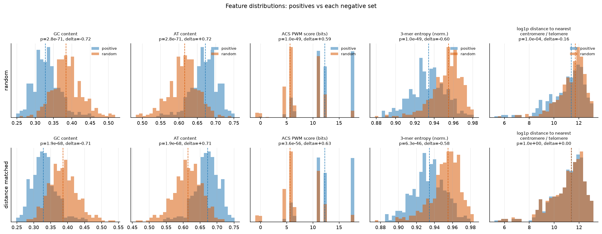
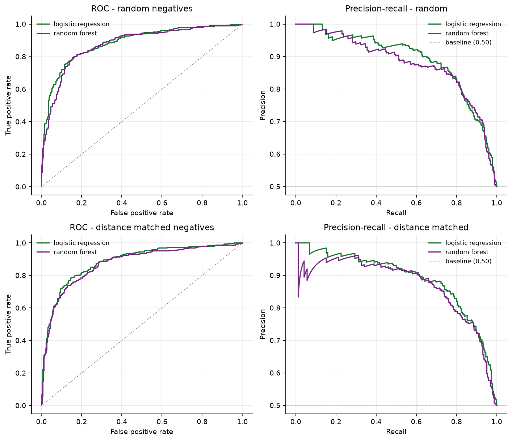
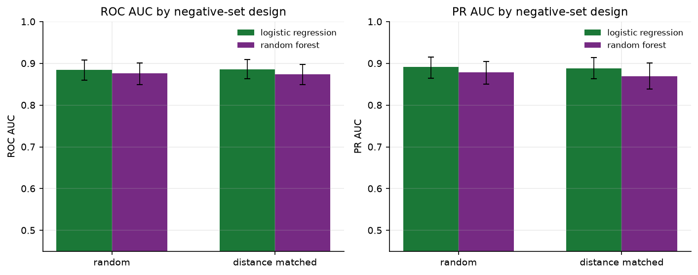
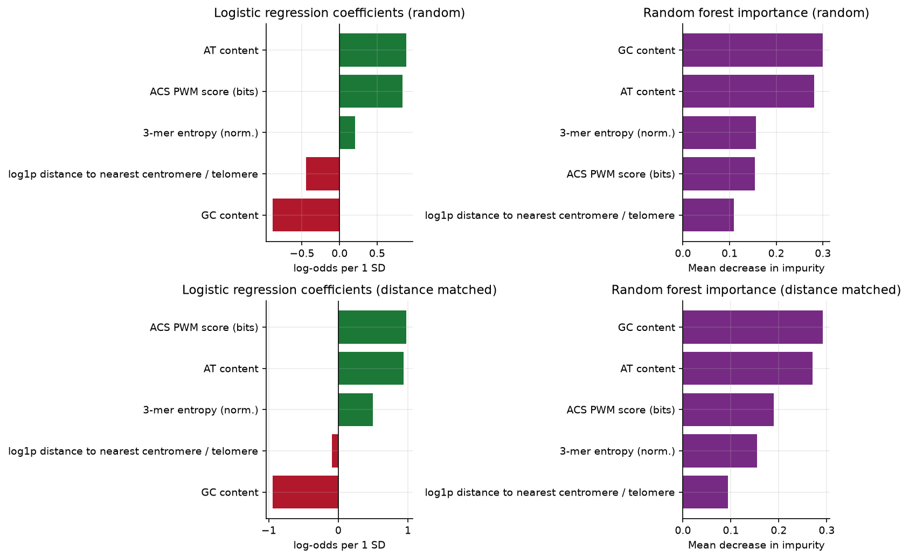

# 用序列特征预测酿酒酵母复制起始点（ARS）

一个**一周可复现**的小项目：从公开数据库获取实验验证的 ARS 坐标，用 5 个序列特征、逻辑回归（主）与随机森林（对照）做二分类，并按染色体做分组交叉验证。项目重点不是把 AUC 刷高，而是回答一个方法学问题：

> **负样本怎么构造，会怎样改变我们以为模型"学到了"的东西？**

---

## TL;DR

- 正样本：OriDB 中 **410** 条 Confirmed ARS，去重叠后 **408** 个 500 bp 窗口；负样本两组各 **408** 个（全基因组随机窗口 / 距离匹配窗口）。
- 逻辑回归在两组负样本上几乎相同：ROC-AUC **0.885**（随机）vs **0.886**（距离匹配），差值 95% CI 为 **[-0.022, 0.019]**，bootstrap p≈0.94。
- 只用"到着丝粒/端粒距离"时 AUC 仅 **0.50–0.57**；只用 4 个序列特征时 AUC 仍有 **0.88**。**判别力来自序列组成，而非基因组位置**。
- 但把基准率换成全基因组真实水平（约 **1.7%**）后，同一模型的 PPV 只有 **6–7%**——高 AUC 不等于高可信度。这是本项目与统计思维教材衔接的关键点。

---

## 1. 问题

酿酒酵母（*Saccharomyces cerevisiae*）的 DNA 复制从基因组上数百个**自主复制序列（ARS, autonomously replicating sequence）**起始。ARS 通常约 100–300 bp，含一个 11 bp 的 **ACS 保守基序**（`(A/T)TTTA(T/C)(A/G)TTT(A/T)`），但仅靠 ACS 匹配无法可靠地区分真正的起始点：ACS 在全基因组中大量出现，且多数并不活跃。

本项目问两个问题：

1. **只用 5 个粗粒度的序列特征，能否把实验验证的 ARS 与背景基因组窗口区分开？**
2. **如果改变负样本的构造方式（随机背景 vs 距离匹配背景），模型表现和解释会怎样变化？**

第二个问题是核心。随机负样本通常位于 GC 含量、基因密度、距着丝粒距离都与 ARS 不同的区域；模型可能只是学会了"ARS 在 AT 丰富、靠近着丝粒的区间"，而不是识别 ARS 本身。距离匹配负样本固定了位置因素，用来检验这一点。

---

## 2. 数据

| 数据 | 来源 | 版本 / 访问 | 用途 |
|---|---|---|---|
| 参考基因组 | NCBI RefSeq **GCF_000146045.2**（S288C，R64 / sacCer3） | 2026-11-07 | 提取 500 bp 序列；16 条核染色体共 12,071,326 bp |
| ARS 坐标 | **OriDB** `sc_ori` 表，`status == Confirmed` | 访问于 2026-11-07（站点未提供版本号） | 410 条正样本；取注释区间中点 |
| 着丝粒 | **SGD_features.tab** | 2026-11-07 | 16 个着丝粒中点 |
| 端粒 | 染色体两端（0 与染色体长度） | — | 距离特征的近似 |

- 正样本：以 ARS 注释中点为中心的 **500 bp** 窗口；中点相距 < 500 bp 的条目合并，最终 **408** 个。
- 负样本 A（`random`）：按染色体长度加权、全基因组均匀抽取的 500 bp 窗口，要求距任何正样本中点 ≥ 1 kb、N 碱基占比 ≤ 2%。
- 负样本 B（`distance_matched`）：每个正样本配一个同染色体的负窗口，使其"到最近着丝粒/端粒"的距离与正样本匹配；同样排除正样本邻近区域与 N 多的窗口。
- 匹配质量：正/负距离中位数 **88,328 vs 87,775 bp**；|Δlog1p| 的 95% 分位为 **0.020**；距地标 <10 kb 的比例两边均为 **10.5%**；Mann-Whitney p = **0.997**。

> 原始基因组、OriDB 表和 SGD 表**不提交进仓库**（见 `.gitignore`）。`scripts/download_data.py` 会重新下载，并写入含 URL、字节数、SHA-256、下载日期的 `data/raw/download_manifest.json`。
> 详细的来源、版本、许可以及已知偏差见 [docs/data-card.md](docs/data-card.md)。

**离线替代方案**：仓库内置 `data/sample/sample_dataset.csv`（15 正 + 15 随机负 + 15 匹配负，含序列与坐标），可用于不联网的冒烟测试（`python scripts/smoke_test.py`）；它**不能**用于复现正式结果。所有正式坐标均来自公开数据库，未编造或平移。

---

## 3. 方法

### 3.1 五个特征

| 特征 | 定义 | 说明 |
|---|---|---|
| `gc_content` | (G+C)/500 | 整体 GC 含量 |
| `at_content` | (A+T)/500 | 与 GC 完全互补（1−GC），保留是为了直接检验 AT 丰富性 |
| `acs_pwm_max` | ACS 11 bp PWM 的最大 log-odds 得分（双链、全窗口滑窗） | 固定位 0.98、简并位 0.49/0.49，背景 0.25；理论最大 18 bits |
| `kmer3_entropy` | 64 种 3-mer 频率的 Shannon 熵，除以 log2(64) | 序列复杂度的粗摘要 |
| `dist_cen_tel_log` | log1p(min(到着丝粒中点距离, 到染色体两端距离)) | 位置因素 |

`gc_content` 与 `at_content` 在数值上严格共线（AT = 1 − GC）。标准化后二者的逻辑回归系数会互为相反数，**应把它们合并解释**：净效应 ≈ β_AT·(AT − GC)，即"越 AT 丰富，log-odds 越高"。

### 3.2 模型

- **逻辑回归（主模型）**：标准化 + L2，`C=1.0`，`lbfgs`，不调参。
- **随机森林（对照）**：300 棵树，`min_samples_leaf=5`，`max_features="sqrt"`，`class_weight="balanced"`，不调参。
- 固定超参数是刻意选择：一周范围内不做超参搜索，避免把交叉验证当成调参集。

### 3.3 评估协议

- **按染色体分组交叉验证**：`LeaveOneGroupOut`，16 条染色体各留出一次。测试染色体上的任何窗口都不参与训练，避免相邻位点泄漏。
- 指标：**ROC-AUC** 与 **PR-AUC**（`average_precision`）。二分类数据 1:1 平衡，PR-AUC 的随机基线为 0.50。
- **Bootstrap 95% CI**：对合并后的 out-of-fold 预测做 1,000 次分层重采样（正、负各自重采样，保持类别比例），取 2.5/97.5 分位。
- **两种负样本的差异**：以正样本为配对单位做配对 bootstrap，得到 ΔAUC 的 95% CI 与双侧 bootstrap p 值。
- **单特征检验**：Mann-Whitney U（双侧），同时报告 **Cliff's delta** 效应量，并对 5 个特征 × 2 组负样本做 **Benjamini-Hochberg FDR** 校正。

---

## 4. 结果

### 4.1 单特征分布与检验



| 特征 | 正样本中位数 | 随机负样本 | Cliff's δ | FDR p | 匹配负样本 | Cliff's δ | FDR p |
|---|---:|---:|---:|---:|---:|---:|---:|
| GC 含量 | 0.328 | 0.384 | **−0.72** | 2.8e−71 | 0.386 | **−0.71** | 1.9e−68 |
| AT 含量 | 0.672 | 0.616 | **+0.72** | 2.8e−71 | 0.614 | **+0.71** | 1.9e−68 |
| ACS PWM | 12.25 | 5.63 | **+0.59** | 1.0e−49 | 5.63 | **+0.63** | 3.6e−56 |
| 3-mer 熵 | 0.934 | 0.955 | **−0.60** | 1.0e−49 | 0.955 | **−0.58** | 6.3e−46 |
| 距离（log1p） | 11.389 | 11.715 | −0.16 | 1.0e−4 | 11.383 | 0.00 | 0.997 |

正样本明显更 AT 丰富、ACS 得分更高、3-mer 熵更低。距离在随机负样本中只有很小的差异（δ = −0.16），在匹配负样本中被完全对齐（δ = 0.00）。**所有 p 值都极小，但真正值得看的是效应量**：距离的效应量在匹配后归零，而序列特征的效应量几乎不变。

### 4.2 模型判别力



| 负样本构造 | 模型 | ROC-AUC [95% CI] | PR-AUC [95% CI] |
|---|---|---:|---:|
| 随机 | 逻辑回归 | **0.885** [0.860, 0.908] | **0.891** [0.865, 0.915] |
| 随机 | 随机森林 | 0.877 [0.849, 0.901] | 0.879 [0.851, 0.904] |
| 距离匹配 | 逻辑回归 | **0.886** [0.863, 0.909] | **0.888** [0.864, 0.914] |
| 距离匹配 | 随机森林 | 0.873 [0.849, 0.897] | 0.869 [0.838, 0.901] |

### 4.3 核心对比：两种负样本



以正样本为配对单位的 bootstrap 差异（随机 − 匹配）：

| 模型 | ΔROC-AUC [95% CI] | bootstrap p | ΔPR-AUC [95% CI] | bootstrap p |
|---|---:|---:|---:|---:|
| 逻辑回归 | −0.0006 [−0.022, 0.019] | 0.94 | +0.0030 [−0.024, 0.031] | 0.85 |
| 随机森林 | +0.0035 [−0.019, 0.025] | 0.84 | +0.0095 [−0.026, 0.044] | 0.67 |

**没有证据表明两种负样本会改变判别力。** 消融实验解释了原因：

| 特征子集 | 随机负样本 AUC | 距离匹配负样本 AUC |
|---|---:|---:|
| 仅距离 | 0.569 [0.528, 0.609] | **0.500** [0.458, 0.538] |
| 仅 4 个序列特征 | 0.880 [0.854, 0.904] | **0.886** [0.864, 0.909] |

在这批特征下，位置只贡献了很小的判别力；随机负样本并未像常见担忧那样"放大"性能。**项目的核心结论因此是：这套 5 特征模型的信号主要来自序列组成（AT 丰富度、ACS、3-mer 复杂度）；改变负样本的位置匹配方式几乎不改变结果。**

需要强调，这是一个**阴性结果**（negative result），不是模型失败的证据。它说明"随机负样本一定高估性能"的担忧在本设定中不成立，也说明仅凭 GC/AT 区分 ARS 与背景仍然可能只是在识别"AT 丰富的基因组区间"。

### 4.4 特征重要性与可解释性



逻辑回归标准化系数（距离匹配负样本）：GC **−0.94**、AT **+0.94**、ACS **+0.98**、3-mer 熵 **+0.49**、距离 **−0.09**。GC 与 AT 的系数互为相反数，净效应是"GC 每低 1 个标准差，log-odds 提高约 1.88"。随机森林的重要性排序一致：GC 0.29、AT 0.27、ACS 0.19、熵 0.15、距离 0.09。

### 4.5 从 precision/recall 到 PPV：基准率会改变一切

训练集刻意做成 1:1，此时 precision 可以直接读作 PPV。但真实筛查场景的基准率远低于 50%：408 个正窗口 / 约 24,142 个全基因组 500 bp 窗口 ≈ **1.69%**。

在阈值 0.5 下（out-of-fold 预测）：

| 负样本 | 模型 | 灵敏度 | 特异度 | PPV@1.69% | PPV@5.8% | PPV@50% | 需检查窗口数/命中 |
|---|---|---:|---:|---:|---:|---:|---:|
| 随机 | 逻辑回归 | 0.814 | 0.816 | **7.1%** | 21.4% | 81.6% | 14.1 |
| 随机 | 随机森林 | 0.801 | 0.828 | **7.4%** | 22.3% | 82.4% | 13.5 |
| 距离匹配 | 逻辑回归 | 0.814 | 0.801 | **6.6%** | 20.2% | 80.4% | 15.2 |
| 距离匹配 | 随机森林 | 0.784 | 0.804 | **6.4%** | 19.8% | 80.0% | 15.5 |

这就是教材 PSA 例子的迁移：即使灵敏度 80%、特异度 70%，在 5.8% 基准率下 PPV 也只有约 16%。本项目模型看起来"很准"（AUC≈0.89），但在全基因组基准率下，**每 14–15 个被预测为阳性的窗口只有约 1 个是真的**。它适合做候选排序/实验优先级，不适合做"这是不是 ARS"的最终判定。

---

## 5. 结论

1. 5 个粗粒度特征足以把 Confirmed ARS 与背景窗口区分开（ROC-AUC ≈ 0.88），但其中 GC/AT 与 ACS 贡献最大，3-mer 熵次之。
2. 两种负样本构造给出几乎相同的 AUC/PR-AUC（ΔAUC 的 95% CI 覆盖 0），距离特征在匹配后完全失去判别力（AUC=0.50）。**随机负样本没有在本项目中制造明显乐观偏差**——因为模型本来就没有依赖位置。
3. 高 AUC 不等于高 PPV：在 1.69% 的真实基准率下 PPV 只有 6–7%，模型只能作为候选筛选器。
4. 结论的边界很清楚：它成立的前提是"500 bp 窗口 + 这 5 个特征 + OriDB Confirmed 标签"。换特征、换标签、换窗口宽度，结论都可能改变。

---

## 6. 统计思维：与教材的对应

本项目的方法论述评参照 *Statistical Thinking for the 21st Century*（Russell A. Poldrack, 2019, 18 章），完整对照表由另一条工作流维护在 [docs/book-mapping.md](docs/book-mapping.md)（只读，本仓库不修改）。

**重要边界**：该教材**没有**逻辑回归、ROC/AUC、PR-AUC、随机森林、类别不平衡、按染色体分组交叉验证的专门章节（Ch.14 §14.4 仅一段提到广义线性模型）。因此本仓库把这些方法明确写成"**超出教材范围的延伸**"，不声称书中有对应依据。教材真正支撑的是下面八个统计概念：

| 概念 | 在本项目中的落地 |
|---|---|
| 抽样偏差 | 正样本只含"已被实验验证"的 ARS（确认偏差）；负样本有两种构造；两者都要在结论里交代 |
| 基准率与 PPV | §4.5：把 1:1 训练集上的 precision 换算到 1.69% 全基因组基准率，PPV 从 ~80% 跌到 6–7% |
| 过拟合与交叉验证 | LeaveOneGroupOut 按染色体留出，避免相邻位点泄漏；不做超参搜索 |
| Bootstrap 置信区间 | 1,000 次分层重采样，报告 AUC/PR-AUC 的 95% CI 与 ΔAUC 的 CI |
| 效应量 | 每个特征报 Cliff's delta，而不只报 p 值；AUC 差异报 CI |
| 多重比较 | 5 特征 × 2 负样本共 10 次检验，用 BH-FDR 校正（Bonferroni 是更保守的替代） |
| p 值的正确解释 | p 小只说明"在零假设下不寻常"，不说明效应大小或模型可用性；因此同时给出 δ 与 CI |
| 可复现性 | 固定 seed、下载清单（URL/字节/SHA-256/日期）、版本锁定、`run_all.py` 一键复现 |

---

## 7. 局限与后续

**局限**

- 标签只有 408 条 Confirmed ARS；OriDB 的"Confirmed"本身依赖质粒/复制起点测定，稀有或低效起始点可能缺失。
- 500 bp 窗口是人为选择；ACS 在窗口中的位置未对齐，PWM 取全窗口最大值会受局部 AT 富集影响。
- GC 与 AT 完全共线；模型可能主要在识别"AT 丰富的基因组区间"，而不是 ARS 特异结构。
- 两类负样本都是"人工背景"，不是实验测定的非起始点；PR-AUC 的绝对值不能直接外推到全基因组。
- 只用一个菌株/一个组装版本；没有染色质、核小体、复制时序等信息（按项目范围刻意排除）。
- 随机森林重要性基于不纯度，对连续特征有偏；未做置换重要性。
- 分层 bootstrap 的 CI 假设窗口近似独立，但同一染色体上的窗口存在空间相关，CI 可能偏窄。

**后续（按性价比排序）**

1. 用**实验测定的 ARS-negative 片段**替代随机负样本，做更严格的对照。
2. 增加 ACS 的位置/链方向特征，以及 5-mer PWM 或简单 k-mer 逻辑回归。
3. 做概率校准（Platt/isotonic）并报告校准曲线，让 PPV 估计可用于实际筛选。
4. 引入染色质可及性/核小体占据（需额外数据许可与处理时间）。
5. 在另一株酿酒酵母或近缘种上外部验证，检验结论的泛化边界。

---

## 8. 复现

```bash
# Python 3.10+（本项目在 3.12 上验证）
python -m venv .venv
# Windows: .venv\Scripts\activate
# macOS/Linux: source .venv/bin/activate
pip install -r requirements.txt

python scripts/run_all.py
```

一条命令完成：下载 → 构建窗口与特征 → 两种负样本的 LOGO 交叉验证 → bootstrap CI → 图与表。首次运行约 1 分钟（本机 55 s，含 1,000 次 bootstrap）。若数据已下载，可用：

```bash
python scripts/run_all.py --skip-download --skip-build
```

**离线冒烟测试**（只用仓库内置的 45 个窗口，不做正式结论）：

```bash
python scripts/smoke_test.py
```

**主要输出**

| 文件 | 内容 |
|---|---|
| `results/figures/fig1_feature_distributions.png` | 5 特征 × 2 负样本分布与检验标注 |
| `results/figures/fig2_roc_pr.png` | ROC / PR 曲线（两种负样本 × 两个模型） |
| `results/figures/fig3_feature_importance.png` | LR 系数与 RF 重要性 |
| `results/figures/fig4_metrics_comparison.png` | AUC / PR-AUC 带 bootstrap CI 对比 |
| `results/metrics_table.csv` | 主结果 + 消融 |
| `results/feature_tests.csv` | Mann-Whitney + Cliff's δ + BH-FDR |
| `results/negative_set_comparison.json` | ΔAUC / ΔPR-AUC 的配对 bootstrap |
| `results/ppv_table.csv` | 不同基准率下的 PPV / NPV |
| `results/oof_predictions.csv` | 每个窗口的 out-of-fold 分数 |

---

## 9. 仓库结构

```
yeast-ars-prediction/
├── ars/                      # 可复用模块
│   ├── config.py             # 路径、常量、固定超参
│   ├── genome.py             # FASTA / 着丝粒 / 地标距离
│   ├── dataset.py            # 正样本 + 两种负样本构造
│   ├── features.py           # 5 个特征
│   ├── models.py             # LR / RF 与 LeaveOneGroupOut
│   ├── evaluation.py         # 指标、bootstrap、MWU、PPV、配对差异
│   └── plotting.py           # 四类结果图
├── scripts/
│   ├── download_data.py      # 下载 + manifest
│   ├── build_dataset.py      # 生成 data/processed/dataset.csv
│   ├── run_all.py            # 一键入口
│   └── smoke_test.py         # 离线冒烟测试
├── data/
│   ├── raw/                  # 原始下载（git 忽略）
│   ├── processed/            # 中间数据（git 忽略）
│   └── sample/               # 45 个窗口的示例数据
├── results/                  # 图、指标、预测
├── docs/
│   ├── data-card.md          # 数据卡
│   └── book-mapping.md       # 另一工作流维护，本仓库不改动
├── tests/test_smoke.py
├── README.md
├── LICENSE                   # MIT（仅覆盖代码）
├── requirements.txt
└── .gitignore
```

---

## 10. 与 TRAE 协作：哪些交给 AI，哪些由人判断

**交给 AI 执行**

- 数据端点探测、下载脚本、OriDB HTML 表格解析、SGD 特征表解析；
- 窗口构造、两种负样本采样、5 个特征实现、LOGO 交叉验证、bootstrap、统计检验、绘图；
- 结果表与 README 初稿、数据卡、复现说明。

**由人判断/决定**

- 项目范围：不做 CNN、不引入染色质数据、不做超参搜索、不做网页 demo；
- 数据源与许可：选用 OriDB Confirmed + SGD + NCBI RefSeq，并决定原始数据不入库；
- 核心方法设定：两种负样本的定义、500 bp 窗口、按染色体分组；
- 对"阴性结果"的接受：距离匹配后 AUC 没有下降，不为了迎合预期而换特征/换种子/挑结果；
- PPV 小节与教材口径：明确教材不支持 LR/ROC/PR/RF/分组 CV，只能作为统计推理的延伸。

**踩过的坑（都已修复并体现在代码里）**

1. **Ensembl Fungi 的 TLS 证书在本机校验失败** → 改用 NCBI RefSeq `GCF_000146045.2`（同一 R64 组装、同一坐标系），并在数据卡记录变更。
2. **OriDB 不返回裸 TSV**，而是把表包在 HTML `<textarea>` 里 → 解析 payload，而不是假设 `read_csv(url)` 可用。
3. **距离匹配的初版有逻辑错误**：在某个地标 ±d 处放窗口，并不保证"到最近地标"的距离是 d（着丝粒可能更近）。初版因此出现正负距离中位数 88 kb vs 66 kb。修复方式是逐个候选计算真实最近距离并按容差过滤，最终中位数 88.3 kb vs 87.8 kb。
4. **GC 与 AT 完全共线**：LR 给出 −0.94/+0.94 的镜像系数。没有删掉 AT（题目要求保留 5 个特征），而是在 README 中合并解释净效应。
5. **分组 CV 的实现**：16 条染色体用 `GroupKFold(n_splits=16)` 并不自然，改用 `LeaveOneGroupOut`，每条染色体恰好留出一次。
6. **原始数据与仓库体积**：`.gitignore` 排除 `data/raw`、`data/processed`、虚拟环境、缓存与凭证；只提交 45 个窗口的示例数据和下载脚本。
7. **"高 AUC"的诱惑**：最初预期"距离匹配会让 AUC 明显下降"，实际没有。最终按实际结果写结论，并把 PPV 作为更重要的可用性约束。

---

## 11. 数据来源与许可

- **代码**：MIT，见 [LICENSE](LICENSE)。
- **数据不随仓库分发**，由脚本从公开数据库获取。使用时请引用：
  - OriDB：Nieduszynski et al. (2012) *Nucleic Acids Research*；OriDB 数据面向学术研究免费使用，商用/再分发前请核对站点条款。
  - SGD：Saccharomyces Genome Database，`SGD_features.tab`；请遵循 SGD 使用条款并引用 SGD。
  - 基因组：NCBI RefSeq `GCF_000146045.2`（S288C R64）。
- 本项目仅用于方法与统计教学演示，不构成对任何位点的实验结论。
